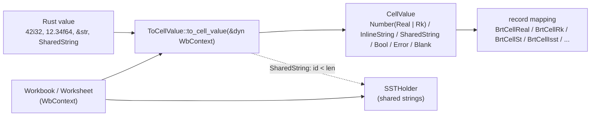

# Cell values, workbook context, and shared-string ids

- Status: Implemented (slices 1–7; `e2e` migration and temporal values included)
- Superseded in part by: `2026-11-18-xlsxwriter-compatible-api-design.md`
  (§2 ownership; §3 inline-string rule is low-level only; §5.7 ownership; §11
  performance levers; §13 item 1 constructor)
- Date: 2026-11-18
- Method pack: Aegis design spec
- Target: `rust-xlsb-core`, MS-XLSB revision 22.0
- Supersedes: none

## 1. Context and change necessity

`rust-xlsb-core` currently has two disconnected halves:

- The record layer (`prelude/record/*`, `prelude/structure/*`) can serialize
  every cell record needed for a worksheet, and `SSTHolder`
  (`src/sst_sqlite.rs`) interns strings and emits the Shared Strings part.
- Package assembly exists only inside the test-only `e2e` module
  (`src/e2e/harness.rs`), which builds shared strings as raw `u32` indices and
  picks cell records by hand in a match statement.

That hand-written mapping has three problems this spec removes:

1. A shared-string index is an untyped `u32`. Nothing checks that it belongs to
   the workbook it is written into, and the check cannot be added once the
   writer has already chosen `BrtCellIsst`.
2. Value-to-record decisions (Real vs Rk vs RkPercent, inline vs shared string)
   are duplicated at every call site instead of being owned by one conversion
   contract.
3. The workbook has no shared-string owner. `SSTHolder::push` already works
   through `&self` (SQLite connection behind `Arc`), so a workbook can own the
   table, but nothing models that ownership.

Introducing `ToCellValue` / `WbContext` now, before a public package writer
exists, keeps the contract small: no migration of user code is required, the
`e2e` harness is the only consumer, and the future writer consumes a
`CellValue` that is already validated.

## 2. Goals

> Superseded for the public writer: core no longer owns `Workbook` /
> `Worksheet`; those types move to `rust-xlsb-writer`.

- One conversion contract from Rust values to semantic cell values
  (`ToCellValue`), taking the target workbook context.
- Shared strings as a workbook-agnostic `SharedString { id: u32 }`, validated
  against the target workbook's `SSTHolder` at conversion time.
- A `WbContext` trait whose minimum obligation is returning the workbook's
  `SSTHolder`, with provided methods for lossless number encoding policy.
- The first real `Workbook` / `Worksheet` types: `Workbook` owns `SSTHolder`,
  `Worksheet` borrows it and implements `WbContext`.
- End-to-end tests prove each conversion through `calamine`, as today.

## 3. Non-goals

> Superseded for the public writer: `IntoExcelData` strings intern to the SST.
> This low-level inline rule remains for `ToCellValue` only.

- Number formats and styles. A cell's style index stays an orthogonal field
  next to `CellValue`; temporal tests keep using the harness' style slot.
  Temporal values themselves are §5.8.
- Formulas, rich text, error-bar metadata, or merged cells.
- Automatic interning of `&str`. `&str` converts to an inline string; shared
  strings are always an explicit workbook operation.
- Deleting or replacing shared strings. `SSTHolder` remains insert-only, which
  is what makes the id-range invariant cheap.
- Reusing one `SSTHolder` across write attempts or reopening a persisted table.
  The holder is write-session scratch and is dropped with the workbook.
- Frequency-ordered SST remapping. Ids stay insertion-ordered: reordering items
  by hit count would change the `SharedString` contract (ids held by cells no
  longer match emitted ids) and does not speed up readers that materialize the
  whole SST before resolving cells (§10).
- Thread-safe `WbContext`. `SSTHolder` wraps `Arc<rusqlite::Connection>` and is
  neither `Send` nor `Sync`; no bounds are added, and parallel batch writers
  will need per-thread holders or external locking.
- The package writer itself. This spec stops at `CellValue`; mapping records,
  zip parts, and `[Content_Types]` remains test-harness code until the writer
  lands.

## 4. Current facts the design relies on

| Fact | Source |
|---|---|
| `SSTHolder::push(&self, &str) -> Result<u32, SSTHolderError>` returns `ROWID - 1`; `push_batch` does the same under one transaction | `src/sst_sqlite.rs` |
| The table is created empty and has no delete path; ids are contiguous `0..len` | `src/sst_sqlite.rs` (`initialize`, `push`) |
| The holder is write-session scratch: every constructor creates a fresh empty table and the holder is dropped with the workbook after the write, success or error, so a failed write leaves no reusable table | `src/sst_sqlite.rs`; design intent |
| `SSTHolder` is `Clone` (shares one `Arc<Connection>`) and mutation works through `&self` | `src/sst_sqlite.rs` |
| `RkNumber::int` accepts the signed 30-bit range `-2^29..=2^29 - 1`; `percent` sets `fx100`; `float` accepts only doubles whose low 34 bits are zero | `src/prelude/structure/rk_number.rs` |
| Cell records already exist: `BrtCellReal`, `BrtCellRk`, `BrtCellBool`, `BrtCellError`, `BrtCellBlank`, `BrtCellSt`, `BrtCellIsst` | `src/prelude/record/` |
| `calamine` reads Rk int as `Data::Int`, Rk f64/percent and Real as `Data::Float`, both string records as `Data::String` | verified in `e2e` |
| Excel stores dates and times as one serial `f64` (1900 epoch, fake 1900-02-29); `calamine` resolves serials to milliseconds and applies the `f < 60` shift | `calamine` `src/datatype.rs`; verified in `e2e` |
| `Xnum(f64)` is the body of `BrtCellReal`; Rk is an alternative encoding of the same f64, not a different scalar type | `src/prelude/structure/xnum.rs`, `src/prelude/record/brt_cell_real.rs` |
| `CheckedBiff`/`BiffWrite` require a record instance before an id is known | `src/biff.rs` |

## 5. Proposed model



Three new modules, each owning one concern:

| Module | Public items |
|---|---|
| `src/context.rs` | `SharedString`, `WbContext`, `NumberPolicy`, `NumberEncoding` |
| `src/cell_value.rs` | `CellValue`, `ToCellValue` |
| `src/workbook.rs` | `Workbook`, `Worksheet<'wb>` |
| `src/temporal.rs` | `ToCellValue` impls for `chrono` types; no new public items |

`lib.rs` re-exports all of them, plus `SSTHolderError` (needed by the new
`Error` variant). No existing public item changes shape.

### 5.1 `SharedString`

```rust
/// A shared-string reference. Carries no workbook handle: the same value may be
/// written into any workbook whose SST contains `id`.
#[derive(Debug, Clone, Copy, PartialEq, Eq, Hash)]
pub struct SharedString {
    id: u32,
}

impl SharedString {
    pub const fn id(&self) -> u32;
}
```

Construction is only through a context (`WbContext::shared_string`) or the
writer's own interning; there is no public `from_id` until a caller needs to
replay ids from an external table. Validation happens in
`ToCellValue for SharedString`, never in the constructor.

### 5.2 `CellValue`

```rust
#[derive(Debug, Clone, PartialEq)]
pub enum CellValue {
    Blank,
    Bool(bool),
    Error(BErr),
    Number(NumberEncoding),
    SharedString(SharedString),
    InlineString(String),
}
```

`CellValue` is semantic: it does not carry a style index, a row, or a column.
Record mapping (in the future writer):

| `CellValue` | Record |
|---|---|
| `Blank` | `BrtCellBlank` |
| `Bool(v)` | `BrtCellBool { fBool: v }` |
| `Error(e)` | `BrtCellError { bError: e }` |
| `Number(Real(v))` | `BrtCellReal { xnum: v.into() }` |
| `Number(Rk(rk))` | `BrtCellRk { value: rk }` |
| `SharedString(s)` | `BrtCellIsst { isst: s.id() }` |
| `InlineString(s)` | `BrtCellSt { value: s }` |

`s.id()` is the *emitted* id under the current insertion-order policy. Any
future workbook ordering policy would have to remap ids at serialization, so
`s.id() == isst` is guaranteed only while ids remain insertion-ordered (§3).

### 5.3 `NumberEncoding` and `NumberPolicy`

```rust
#[derive(Debug, Clone, Copy, PartialEq)]
pub enum NumberEncoding {
    Real(f64),
    Rk(RkNumber),
}

#[derive(Debug, Clone, Copy, PartialEq, Eq)]
pub struct NumberPolicy {
    pub integers: bool,
    pub percents: bool,
    pub rk_floats: bool,
}

impl Default for NumberPolicy {
    fn default() -> Self {
        Self { integers: true, percents: true, rk_floats: true }
    }
}

impl NumberPolicy {
    pub fn encode_f64(&self, value: f64) -> NumberEncoding;
}
```

`encode_f64` is a pure function, unit-testable without a workbook. Precedence
and guards, in order:

1. If `!value.is_finite()` or `value == 0.0 && value.is_sign_negative()`, stop:
   non-finite and negative zero are only representable as `Real`. `Rk` cannot
   carry the sign of zero, and non-finite values should not claim a compact
   integer path.
2. `integers` and `value.fract() == 0.0` and
   `-536_870_912.0 <= value <= 536_870_911.0` (the signed 30-bit range):
   `Rk(RkNumber::int(value as i32))`.
3. `percents` and the scaled value round-trips bit-exactly:
   `let scaled = (value * 100.0).round();`
   `scaled >= -536_870_912.0 && scaled <= 536_870_911.0` and
   `(scaled / 100.0).to_bits() == value.to_bits()`:
   `Rk(RkNumber::percent(scaled as i32))`.
4. `rk_floats` and `RkNumber::float(value)` is `Some`:
   `Rk(rk)`.
5. Otherwise `Real(value)`.

Every accepted `Rk` reconstructs `value` bit-exactly; this is the fidelity
invariant of the whole design. Examples:

| Input | Encoding | Why |
|---|---|---|
| `42.0` | `Rk(int 42)` | integral, in range |
| `-0.0` | `Real(-0.0)` | `Rk` would drop the sign |
| `0.1` | `Rk(percent 10)` | `10 / 100.0` has the same bits as `0.1` |
| `1.5` | `Rk(percent 150)` | percent precedes the Rk-float rule |
| `2f64.powi(29)` | `Rk(float)` | outside the int range, but fract 0 keeps it out of percent, and bits fit `RkNumber::float` |
| `1e-9` | `Real` | percent rounds to 0, which does not round-trip |
| `f64::NAN`, `f64::INFINITY` | `Real` | non-finite guard |
| `3.141_592_653_589_793` | `Real` | no compact form is exact |

Integer conversion additionally covers values outside `f64`'s exact integer
range. It is defined as a provided method on `WbContext` (5.4), so callers get
the same rule through any context; semantics:
- If `integers` is on and the value fits the signed 30-bit range:
  `Rk(int)`.
- Else, if `-9_007_199_254_740_992 <= value <= 9_007_199_254_740_992`
  (`2^53`), `Real(value as f64)`.
- Else `Err(Error::ValueNotRepresentable("integer exceeds f64 precision"))`.

`u64` values above `i64::MAX` map to the same error before casting.

### 5.4 `WbContext`

```rust
pub trait WbContext {
    /// The workbook's shared-string table.
    fn shared_strings(&self) -> &SSTHolder;

    /// Encoding policy for numbers. Defaults to `NumberPolicy::default()`.
    fn number_policy(&self) -> NumberPolicy {
        NumberPolicy::default()
    }

    /// Interning operation. Mutates the SST through `&self`.
    fn shared_string(&self, value: &str) -> crate::Result<SharedString> {
        let id = self.shared_strings().push(value)?;
        Ok(SharedString { id })
    }

    /// Infallible: every `f64` is representable as `Real`.
    fn store_f64(&self, value: f64) -> NumberEncoding {
        self.number_policy().encode_f64(value)
    }

    /// f32 widens to f64 exactly; kept as a separate method so a workbook can
    /// return a different policy for f32 input if it ever needs to.
    fn store_f32(&self, value: f32) -> NumberEncoding {
        self.store_f64(f64::from(value))
    }

    /// Fallible: integers outside f64's exact range are rejected, not rounded.
    fn store_integer(&self, value: i64) -> crate::Result<NumberEncoding> {
        const RK_MIN: i64 = -536_870_912; // -2^29
        const RK_MAX: i64 = 536_870_911; // 2^29 - 1
        const F64_EXACT: i64 = 9_007_199_254_740_992; // 2^53

        if self.number_policy().integers && (RK_MIN..=RK_MAX).contains(&value) {
            let value = i32::try_from(value).expect("range checked above");
            let rk = RkNumber::int(value).expect("range checked above");
            return Ok(NumberEncoding::Rk(rk));
        }
        if (-F64_EXACT..=F64_EXACT).contains(&value) {
            // Exact by construction: every i64 in this range is an f64.
            return Ok(NumberEncoding::Real(value as f64));
        }
        Err(Error::ValueNotRepresentable(
            "integer exceeds f64 precision",
        ))
    }
}
```

Only `shared_strings` is required. `WbContext` stays object-safe (no generics,
no `Self` returns), so `&dyn WbContext` is usable from `ToCellValue`.

### 5.5 `ToCellValue`

```rust
pub trait ToCellValue {
    fn to_cell_value(&self, context: &dyn WbContext) -> crate::Result<CellValue>;
}
```

Object-safe by design: the e2e harness stores `&dyn ToCellValue` per cell.

Impl matrix:

| Type | Result |
|---|---|
| `()` | `Blank` |
| `Option<T: ToCellValue>` | `None -> Blank`, `Some(v) -> v.to_cell_value(ctx)` |
| `bool` | `Bool` |
| `BErr` | `Error` |
| `SharedString` | `SharedString` after range check (5.6) |
| `str`, `String` | `InlineString` (owned copy) |
| `i8`, `i16`, `i32`, `i64`, `u8`, `u16`, `u32`, `u64` | `Number(ctx.store_integer(..)?)`; `u64 > i64::MAX` errors |
| `f32` | `Number(ctx.store_f32(v))` |
| `f64` | `Number(ctx.store_f64(v))` |
| `&T where T: ToCellValue + ?Sized` | forwards to `T` |

`impl ToCellValue for str` (unsized) plus the reference blanket covers `&str`,
`&&str`, `&String`, and `&SharedString` without duplicate impls.

### 5.6 Shared-string validation

```rust
impl ToCellValue for SharedString {
    fn to_cell_value(&self, context: &dyn WbContext) -> crate::Result<CellValue> {
        let len = context.shared_strings().len();
        if self.id < len {
            Ok(CellValue::SharedString(*self))
        } else {
            Err(Error::SharedStringOutOfRange { id: self.id, len })
        }
    }
}
```

The check runs against the *target* context, so one `SharedString` may be
valid in one workbook and invalid in another. `SSTHolder` gains a cached
length:

```rust
impl SSTHolder {
    /// Number of distinct strings; ids are `0..len` because the table is
    /// insert-only and `push` returns `ROWID - 1`.
    #[must_use]
    pub fn len(&self) -> u32;

    #[must_use]
    pub fn is_empty(&self) -> bool;
}
```

The length is an `Arc<AtomicU32>` kept in step with inserts: `push` records
`max(len, id + 1)`, `push_batch` does one update for the whole batch, and both
`create` / `create_in_memory` start at 0 because `initialize` builds a fresh
empty table. There is no reopen-existing-table path by design: a holder lives
as long as one write attempt and is dropped with the workbook, so a failed write
cannot leave a half-populated table that a later write treats as valid. Clones
share the counter, so validation is a single load with no SQL round-trip per
cell. Any future delete or replace path must update the counter in the same
transaction.

### 5.7 `Workbook` and `Worksheet`

```rust
pub struct Workbook {
    sst: SSTHolder,
}

impl Workbook {
    pub fn new() -> crate::Result<Self>;                 // in-memory SST
    pub fn with_sst(sst: SSTHolder) -> Self;             // caller-owned write-session table
    pub fn worksheet(&self) -> Worksheet<'_>;
}

impl WbContext for Workbook {
    fn shared_strings(&self) -> &SSTHolder { &self.sst }
}

pub struct Worksheet<'wb> {
    parent: &'wb Workbook,
}

impl WbContext for Worksheet<'_> {
    fn shared_strings(&self) -> &SSTHolder { self.parent.shared_strings() }
}
```

`with_sst` takes a write-session holder, not a pre-populated database. A holder
starts empty and its length counter is maintained by `push` / `push_batch`, so a
caller may intern strings in the same session before handing it over, but must
not reopen a table from disk; that path is unsupported by design (§4).

`Worksheet` deliberately holds nothing else yet: names, dimensions, and rows
arrive with the worksheet writer. The type exists now because it is the
intended context passed to `to_cell_value` by callers.

### 5.8 Temporal values (`temporal.rs`)

`chrono` types convert through the same `ToCellValue` path into
`CellValue::Number`; no new record or public type is introduced.

| chrono type | Stored value | Typical encoding |
|---|---|---|
| `NaiveDate` | serial day `1..=2_958_465` in the 1900 system | Rk int |
| `NaiveTime` | fraction of a day, rounded to milliseconds | Real (Rk only for exact fractions) |
| `NaiveDateTime` | day serial plus fraction | Real |
| `DateTime<Utc>` | `naive_utc()` wall clock | Real |
| `TimeDelta` | signed day fraction | Real |

Contract:

- Precision is one millisecond, matching Excel and `calamine`; rounding is half
  away from zero. Sub-millisecond components are rounded, not rejected.
- Serials are 1900-system only: no `BrtWbProp` exists, so the 1904 system
  cannot be signalled. Dates before 1900-03-01 are shifted one day earlier to
  skip Excel's fake 1900-02-29, and a datetime that rounds from 1900-02-28 into
  the next day lands on serial 61, not the fake day 60.
- `ValueNotRepresentable` rejects dates outside 1900-01-01..9999-12-31, a
  `NaiveTime` that rounds to the next midnight, a datetime that rounds past
  9999-12-31, and chrono leap seconds (`nanosecond >= 1_000_000_000`).
- `chrono` is `default-features = false, features = ["std"]`; no `clock`
  feature. Only `DateTime<Utc>` has a timezone implementation: Excel stores no
  timezone, and `Local` would make output depend on the host.
- A date serial is an integer, so `NumberPolicy` encodes it as Rk int. Most
  times and all realistic datetimes fail both Rk integer and Rk float tests
  (`1/86_400` has non-zero low 34 bits) and become `BrtCellReal`; the policy may
  still pick Rk percent for exact hundredth fractions such as 12:00:00.

## 6. Error model

`src/err.rs` gains:

```rust
#[error("Shared string id {id} is out of range (len {len})")]
SharedStringOutOfRange { id: u32, len: u32 },

#[error("Value cannot be represented exactly: {0}")]
ValueNotRepresentable(&'static str),

#[error("Shared string table error: {0}")]
Sst(#[from] SSTHolderError),
```

`SSTHolderError` is re-exported from the crate root so the `#[from]` conversion
is usable from outside and documented in rustdoc. `Error::ValidationError`
stays for record-level checks; it is not used for these cases because they need
structured fields.

## 7. Data flow

1. Caller obtains a string id: `let hello = wb.shared_string("hello")?;`
2. Caller converts values: `hello.to_cell_value(&sheet)?`, `42i32.to_cell_value(&sheet)?`,
   `12.34f64.to_cell_value(&sheet)?`.
3. `ToCellValue` consults `NumberPolicy` (provided by the context) or validates
   the shared-string id against `context.shared_strings().len()`.
4. The writer pairs each `CellValue` with row, column, and style, then chooses
   the record from the table in 5.2.
5. At part-writing time the workbook's `SSTHolder` emits `BrtBeginSst` /
   `BrtSSTItem`* / `BrtEndSst`; `BrtCellIsst.isst` values are already known to
   be in range.

## 8. Implementation slices

1. `SSTHolder::len` / `is_empty` with the insert-maintained counter, the three
   `Error` variants, `SSTHolderError` re-export, and the `push` /
   `push_batch` doc fix (both currently say they return a hash; they return the
   shared-string index).
2. `context.rs`: `SharedString`, `NumberEncoding`, `NumberPolicy::encode_f64`,
   `WbContext` with provided methods.
3. `workbook.rs`: `Workbook`, `Worksheet`, both `WbContext` impls.
4. `cell_value.rs`: `CellValue`, `ToCellValue` and the impl matrix.
5. `e2e` migration: replace the harness enum with `&dyn ToCellValue` plus a
   style field; shared strings come from `wb.shared_string`; existing per-type
   tests keep their assertions, new tests cover 9.4.
6. Superseded test helper: harness `CellValue` is deleted, not kept as a second
   conversion path.
7. `temporal.rs`: `chrono` impls, epoch arithmetic, range and precision
   rejection, plus calamine `chrono` feature in `[dev-dependencies]`.

Each slice compiles and passes `cargo test --workspace` on its own; slices 1–3
add no behavior visible to the file format.

## 9. Acceptance criteria

### 9.1 `SSTHolder` length (`sst_sqlite.rs`)

- `len()` is 0 on a fresh holder and increments to 1 after the first `push`.
- Pushing an existing string returns the old id and leaves `len()` unchanged.
- `push_batch(["a", "b", "a"])` returns `[0, 1, 0]` and leaves `len() == 2`.
- A clone observes the length pushed through the original and vice versa.
- Ids returned by `push` / `push_batch` are always `< len()`.

### 9.2 Policy unit tests (`context.rs`)

- `42.0` → `Rk` int 42; `42.5` → `Rk` percent 4250.
- `-0.0` → `Real` with negative sign preserved.
- `0.1` → `Rk` percent 10 and reading back yields the same bits.
- `f64::NAN`, `f64::INFINITY` → `Real`.
- `1e-9` → `Real`.
- `integers = false` moves `42.0` to the percent path (`Rk(percent 4200)`), because `42.0` is also an exact hundredth; disabling `percents` and `rk_floats` as well yields `Real(42.0)`.
- `percents = false` turns `0.1` into `Real(0.1)`.
- `rk_floats = false` turns `2^29` into `Real(2^29)`.
- Every `Rk` produced by `encode_f64` decodes to the input's bits (property
  test over the example set and the boundary values `±2^29`, `±2^29 - 1`,
  `2^53`, `2^-1074`).

### 9.3 Conversion tests (`cell_value.rs`)

- Every impl in the matrix produces the documented variant.
- `Option::<i32>::None` → `Blank`; `Some(-1)` → `Rk` int.
- `SharedString` with `id == len` errors with
  `SharedStringOutOfRange { id, len }`; `id < len` succeeds.
- The same `SharedString` is rejected by a second workbook that never interned
  it.
- `i64::MAX` and `u64::MAX` error with `ValueNotRepresentable`.
- `&str` and `String` produce `InlineString`, never `SharedString`.

### 9.4 End-to-end tests (`e2e`)

- Existing tests still read the same values through `calamine`, now built via
  `to_cell_value`; a shared-string cell uses `wb.shared_string("hello")`.
- A `12.34f64` cell is written as `BrtCellRk` and read back as
  `Data::Float(12.34)`.
- A `42i32` cell is written as `BrtCellRk` and read back as `Data::Int(42)`.
- An invalid `SharedString` (id beyond the SST of the workbook being written)
  fails conversion before any bytes are produced.
- `u64::MAX` fails conversion before any bytes are produced.
- A sheet with only inline strings opens in `calamine` and its package contains
  no `xl/sharedStrings.bin` once the writer path is exercised.

### 9.5 Temporal values (`temporal.rs`, `e2e`)

- Serial days 1900-01-01 → 1, 1900-02-28 → 59, 1900-03-01 → 61,
  2026-11-18 → 46_344, and 9999-12-31 → 2_958_465 read back through `calamine`
  as the same dates.
- `2026-11-18T12:34:56.789` round-trips to the millisecond; `NaiveTime` and
  `TimeDelta` round-trip the exact day fraction.
- A date cell uses `BrtCellRk`; a datetime uses `BrtCellReal`.
- Leap seconds, dates outside the Excel range, and times that round past
  midnight fail before writing.

### 9.6 Quality gates

`cargo test --workspace`, `cargo clippy --workspace --all-targets` (zero
warnings), `cargo fmt --all --check`.

## 10. Alternatives considered

| Alternative | Why rejected |
|---|---|
| `SharedString(pub u32)` newtype only, no context check | No target-workbook validation; the user's stated requirement is exactly that check |
| Borrowed shared string `&'a str` | Ties every cell to the SST lifetime and re-interns on write; ids are the point |
| Auto-intern in `impl ToCellValue for &str` | Hidden mutation during conversion, and inline strings become unreachable |
| `to_cell_value<C: WbContext>(&self, ctx: &C)` | Not object-safe; harness could not store `&dyn ToCellValue` |
| Global `const` number policy | No per-workbook override; the user asked the context to enforce rules |
| `CellValue` carrying a style index | Conflates value and formatting; dates need both independently |
| `SSTHolder::contains(id)` backed by a SQL `EXISTS` query | A DB round-trip per shared-string cell; the cached `len()` plus the insert-only invariant answers the same question in one load |
| Key the table by `UNIQUE(txt)` with `WITHOUT ROWID` (drop `idx`) | Index key becomes the full text, so inserts compare strings instead of an 8-byte hash and the index duplicates the text. 30k rows: +6% insert / +16% size on short strings, +71% insert / +92% size on 190-byte strings (SQLite 3, WAL). `WITHOUT ROWID` also removes the free insertion-order id, forcing an explicit id column and `ORDER BY id` when emitting |
| Encode time/datetime as Rk whenever chrono has a value | Rk has no exact form for 99.7% of whole-second times (`1/86_400` has non-zero low 34 bits); forcing Rk would change the value. The policy already picks Rk for the rare exact fractions |
| `DateTime<Local>` / `DateTime<FixedOffset>` impls | Excel stores no timezone; `Local` makes produced bytes depend on the writer's host zone, and an offset cannot be represented at all. `DateTime<Utc>` is the one unambiguous wall clock |
| Preserve nanoseconds by storing the raw double | A datetime packs date and fraction into one f64, so it already loses up to 314 ns at 2026 and 20 µs at 9999; Excel and `calamine` resolve only milliseconds. Rounding once, at conversion, makes the contract observable and testable |
| Reorder the SST by frequency (top-N ids first) and remap every `isst` | `isst` is an ordinal into a record stream that readers materialize before resolving any cell (`calamine` builds the whole `Vec<String>` then indexes it), so item position does not change lookup cost; load cost is the sum of item bytes either way. The remap adds an O(cells) indirection and a lifecycle hazard: ids held in `SharedString` would no longer match emitted ids. Only deterministic output ordering would be gained |

## 11. Performance levers

> Superseded for the public writer by
> `2026-11-18-xlsxwriter-compatible-api-design.md`: high-level strings use the
> SST and ZIP output is store-only.

Requirements for the writer work that follows this spec. They do not change the
`CellValue` contract.

| Lever | Rule |
|---|---|
| Inline strings for single use | `str` / `String` convert to `InlineString` by default; only callers that know a value repeats intern it as a `SharedString`. A sheet whose cells are all inline emits no `BrtCellIsst`. |
| Omit an empty Shared Strings part | The package writer omits `xl/sharedStrings.bin`, its workbook relationship, and its content-type override when `SSTHolder::len() == 0`. The test harness (§5.7) may keep emitting it until the writer exists. |
| No per-cell SST queries | `push` stays one UPSERT; `push_batch` stays one transaction with one prepared statement; validation uses the cached `len()`; nothing re-queries by string, re-hashes, or scans the table to resolve an id. `write_to_biff_sst` remains a single id-ordered pass. |
| ZIP strategy | The writer deflates binary parts and chooses `Store` only where compression costs more than it saves; the test harness keeps `Store` so fixtures stay inspectable. Both use fixed DOS timestamps and stable part order, so output bytes are deterministic. |

## 12. Risks

- `SSTHolder::len` is a cached counter, not a query. It stays correct only
  while every table is populated through `push` / `push_batch`; a delete or
  replace path must update it in the same transaction.
- `len()` relies on the insert-only, `ROWID - 1` contiguity of `SSTHolder`.
  A later delete or renumbering path must revisit `write_to_biff_sst` ordering
  together with `SharedString` validation.
- Default policy changes alter produced bytes. Golden-file tests, once added,
  must pin `NumberPolicy::default()`.
- `WbContext` is `!Send + !Sync`; nothing in this design may add `Send` bounds
  that rusqlite cannot satisfy.
- `Rk` percent vs Rk float choice is invisible to `calamine` and Excel (both
  `Float`), so a wrong-but-lossless choice will not be caught by round-trip
  tests; unit tests must assert the exact encoding variant.
- Temporal conversion is millisecond-exact by contract. A chrono value with
  nanoseconds is rounded; tests must compare at milliseconds, not nanoseconds.
- 1904-system workbooks are unsupported until `BrtWbProp` exists. Reading such
  a file with these impls would be off by 1462 days.

## 13. Open questions — resolved during implementation

1. `Workbook::new()` returns `Result`; the fallible constructor was kept.
   Superseded by the public writer: `rust_xlsb_writer::Workbook::new()` is
   infallible and defers SQLite errors to `save`.
2. `store_integer` rejects integers above `2^53` with
   `Error::ValueNotRepresentable`; strictness was kept.
3. Temporal precision is one millisecond and sub-millisecond components are
   rounded, matching Excel and `calamine`.
4. The `clock` feature and `Local`/`FixedOffset` impls were dropped;
   `DateTime<Utc>` is the only timezone. Dates outside 1900-01-01..9999-12-31
   are rejected.
