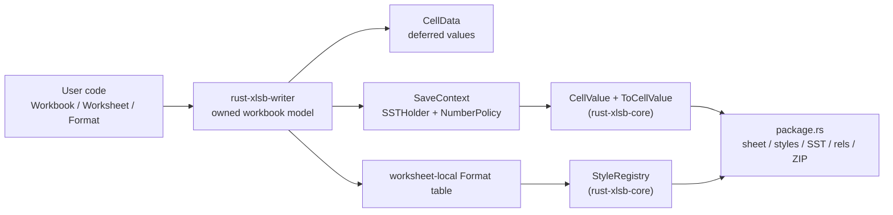

# XLSB writer API compatible with rust_xlsxwriter

- Status: Implemented — writer API and package pipeline (commit `bd797181e0`)
- Date: 2026-11-18
- Method pack: Aegis design spec
- Target: `rust-xlsb-writer`, `rust-xlsb-core`, MS-XLSB revision 22.0
- Reference: `thirdparty/rust_xlsxwriter` v0.102.0, commit `d850973`
- Supersedes: §2, §5.7, §11, and §13 item 1 of
  `2026-11-18-cell-values-and-workbook-context-design.md` (ownership; the
  inline-string and ZIP performance levers; fallible `Workbook::new`). §3's
  inline rule remains for the low-level `ToCellValue` API only.

## 1. Context and change necessity

The project can serialize XLSB records and assemble a minimal package, but it
has no usable writer API. The current public model cannot support the
`rust_xlsxwriter` call flow:

| `rust_xlsxwriter` | current `rust-xlsb-core` |
|---|---|
| `Workbook::new() -> Workbook` | `Workbook::new() -> Result<Workbook>` |
| `add_worksheet(&mut self) -> &mut Worksheet` | `worksheet(&self) -> Worksheet<'_>` |
| `Worksheet` owns cells, rows, columns, formats | `Worksheet<'wb>` only holds row/column style maps |
| `Format::new().set_bold()` | no `Format`; raw `CellStyle` + `BrtXF` |
| `write`, `write_with_format`, `write_row`, `write_column` | absent |
| `save`, `save_to_buffer`, `save_to_writer` | absent; package built in `src/e2e/harness.rs` |
| strings intern during conversion | `ToCellValue` requires `&dyn WbContext` |

The ownership mismatch is the blocker. A borrowed `Worksheet<'wb>` cannot
support this valid `rust_xlsxwriter` sequence:

```rust
let mut workbook = Workbook::new();
let worksheet = workbook.add_worksheet();
worksheet.write(0, 0, "Hello")?;
workbook.save("out.xlsx")?;
```

`worksheet` would still borrow `workbook` when `save` needs `&mut workbook`.

The project already has the low-level pieces: `BrtColInfo`, `BrtRowHdr`,
`BrtXF`, `BrtFont`, `BrtFill`, `BrtBorder`, `CellValue`, `ToCellValue`,
`SSTHolder`, and `StyleRegistry` with deduplication. The missing piece is a
public writer model that owns worksheets, defers interning to save, and emits a
multi-sheet package.

The selected compatibility level is a **source-compatible subset**: same type
and method names, same builder shape, and same `?` flow for the features that
are implemented. It is not a full drop-in replacement for every
`rust_xlsxwriter` feature.

## 2. Goals

- A `Workbook` / `Worksheet` / `Format` API that compiles after changing the
  import path and the output extension for the supported feature set.
- `Workbook` owns worksheets; `add_worksheet` returns `&mut Worksheet`.
- `Workbook::new()` is infallible. Workbook-level I/O and SQLite failures are
  reported by `save`.
- `Worksheet` owns cell data, row options, column options, and a local format
  table. No lifetime parameter and no workbook borrow.
- `Format` is an independent builder, deduplicated by value at save.
- Public `write` uses `IntoExcelData`, matching `rust_xlsxwriter`.
- Public `save`, `save_to_buffer`, and `save_to_writer` emit a complete XLSB
  package with one or more worksheets.
- Strings written through the high-level API use the shared-string table at
  save and emit `BrtCellIsst`.
- Row and column widths, row and column formats, cell formats, fills, borders,
  alignment, and number formats are supported.
- The default font is Calibri 11, matching `rust_xlsxwriter`.
- Existing `rust-xlsb-core` low-level contracts remain available for advanced
  callers and tests.

## 3. Non-goals

- Full `rust_xlsxwriter` surface. v1 omits formulas, array formulas, URLs, rich
  strings, merged ranges, charts, images, tables, conditional formats, data
  validation, notes, textboxes, sparklines, autofilters, defined names, page
  setup, panes, and protection workflows.
- `XlsxError` name compatibility. The error type is `XlsbError`; code that
  names `XlsxError` needs a mechanical rename. Code using `?` or
  `Box<dyn Error>` is unaffected.
- Exact `rust_xlsxwriter` formatting parity beyond the default font. The
  default font is Calibri 11, matching `rust_xlsxwriter`; theme and other style
  defaults remain out of scope.
- Silent integer rounding. `i64` / `u64` values outside `f64`'s exact integer
  range are rejected, even though `rust_xlsxwriter` casts with loss.
- Deflate compression. v1 uses the existing store-only ZIP writer.
- 1904 date system, timezones other than `DateTime<Utc>`, and persisted
  shared-string tables.
- Runtime stubs or no-op methods for unsupported features. Unsupported methods
  are absent at compile time.

## 4. Current facts the design relies on

| Fact | Source |
|---|---|
| `rust_xlsxwriter::Workbook::new()` is infallible | `thirdparty/rust_xlsxwriter/src/workbook.rs` |
| `add_worksheet(&mut self) -> &mut Worksheet` owns worksheets in a `Vec` | `thirdparty/rust_xlsxwriter/src/workbook.rs` |
| `write` and `write_with_format` are generic over `IntoExcelData` and return `Result<&mut Worksheet, XlsxError>` | `thirdparty/rust_xlsxwriter/src/worksheet.rs` |
| `Format` is an independent builder; `set_*` methods take and return `Format` | `thirdparty/rust_xlsxwriter/src/format.rs` |
| `save` auto-adds a worksheet when the workbook is empty | `thirdparty/rust_xlsxwriter/src/workbook.rs` (`save_internal`) |
| `rust_xlsxwriter` uses `RowNum = u32` and `ColNum = u16` | `thirdparty/rust_xlsxwriter/src/worksheet.rs` |
| Current `Workbook::new()` creates an in-memory SQLite SST and returns `Result` | `rust-xlsb-core/src/workbook.rs` |
| Current `Worksheet<'wb>` borrows `&Workbook` and only stores row/column style maps | `rust-xlsb-core/src/workbook.rs` |
| `StyleRegistry` deduplicates fonts, fills, borders, custom number formats, and cell XFs; index 0 is default | `rust-xlsb-core/src/styles.rs` |
| `BrtFont::default()` is Calibri 11 (`dyHeight = 220`) | `rust-xlsb-core/src/prelude/record/brt_font.rs` |
| `SSTHolder::create_in_memory()` is fallible; `push` returns `ROWID - 1`; `write_to_biff_sst` emits the part | `rust-xlsb-core/src/sst_sqlite.rs` |
| `BrtColInfo` and `BrtRowHdr` use LSB-first bit order; `fGhostDirty` marks a row format | `rust-xlsb-core/src/prelude/record/` |
| `BrtFill::solid` sets both colors; MS-XLSB renders only `brtColorFore` for solid fill | `rust-xlsb-core/src/prelude/record/brt_fill.rs`; `[MS-XLSB]` §2.4.681 |
| Package assembly, content types, rels, and ZIP store live in `src/e2e/harness.rs` | `rust-xlsb-core/src/e2e/harness.rs` |
| `BrtColor.nTintAndShade` is a signed 16-bit tint; maximum positive is 100% lightening, maximum negative is 100% darkening | `[MS-XLSB]` §2.4.337 |
| `rust_xlsxwriter` default fill becomes solid when a background color is set without an explicit pattern | `thirdparty/rust_xlsxwriter/src/format.rs` (`set_background_color` docs) |
| `rust_xlsxwriter` swaps foreground/background roles for solid fills in XF styles | `thirdparty/rust_xlsxwriter/src/styles.rs` |

## 5. Proposed model



### 5.1 Crate boundary

`rust-xlsb-core` keeps the low-level contract:

- records, `KnownID`, `BiffWrite`, `BiffHead`
- `SSTHolder`, `SSTHolderError`
- `StyleRegistry`, `CellStyle`
- `CellValue`, `ToCellValue`, `WbContext`, `NumberEncoding`, `NumberPolicy`
- `temporal.rs`

`rust-xlsb-core` loses `Workbook`, `Worksheet`, and `workbook.rs`. Core tests
that used `Workbook` as a conversion context get a test-only `TestContext`
(one `SSTHolder` plus default `NumberPolicy`). `push_record` is re-exported from
the core crate root so the writer can use it.

`rust-xlsb-writer` owns the public API:

| Module | Public items |
|---|---|
| `src/lib.rs` | re-exports, global allocator |
| `src/workbook.rs` | `Workbook` |
| `src/worksheet.rs` | `Worksheet`, `RowNum`, `ColNum`, `IntoExcelData` |
| `src/format.rs` | `Format`, `Color`, `FormatAlign`, `FormatBorder`, `FormatPattern` |
| `src/data.rs` | `CellData`, `IntoExcelData` implementations |
| `src/package.rs` | worksheet, workbook, styles, shared strings, rels, ZIP |
| `src/error.rs` | `Error`, `Result`, `XlsbError` |

`rust-xlsb-writer` adds `chrono` as a dependency and `calamine` as a
dev-dependency. `mimalloc` stays the global allocator.

### 5.2 `Workbook`

```rust
pub struct Workbook {
    worksheets: Vec<Worksheet>,
}

impl Workbook {
    pub fn new() -> Self;
    pub fn add_worksheet(&mut self) -> &mut Worksheet;
    pub fn worksheet_from_index(&mut self, index: usize) -> Result<&mut Worksheet>;
    pub fn save<P: AsRef<Path>>(&mut self, path: P) -> Result<()>;
    pub fn save_to_buffer(&mut self) -> Result<Vec<u8>>;
    pub fn save_to_writer<W: Write + Send>(&mut self, writer: W) -> Result<()>;
}
```

`new()` creates an empty workbook. It does not create SQLite state. `save`
creates the `SSTHolder` and `StyleRegistry` for the write attempt. This makes
`new()` infallible and keeps a failed write from leaving a reusable table.

`save` adds one default worksheet when the workbook has none, matching
`rust_xlsxwriter`. `save` takes `&mut self` so repeated saves are possible.

Sheet names default to `Sheet1`, `Sheet2`, and so on. `save` validates:

- non-empty
- at most 31 characters
- no `[ ] : * ? / \`
- unique case-insensitively

### 5.3 `Worksheet`

```rust
pub struct Worksheet {
    name: String,
    cells: BTreeMap<u32, BTreeMap<u16, Cell>>,
    rows: BTreeMap<u32, RowOptions>,
    columns: BTreeMap<u16, ColumnOptions>,
    formats: Vec<Format>,
    format_ids: HashMap<Format, u32>,
}
```

`Worksheet` has no lifetime parameter. Each cell stores a semantic value and a
worksheet-local format index:

```rust
struct Cell {
    data: CellData,
    format: Option<u32>,
}

struct RowOptions {
    height: Option<f64>,
    format: Option<u32>,
}

struct ColumnOptions {
    width: Option<f64>,
    format: Option<u32>,
}
```

`set_column_width` and `set_column_range_width` write into the per-column map.
Later calls override earlier calls. Adjacent columns with equal width and
format are coalesced into one `BrtColInfo` at save. Implementation: iterate the
sorted column keys, group contiguous keys whose width and format are equal,
and emit one record per group. Columns absent from the map are not emitted.
This replaces the current non-overlapping range model, which cannot express
`rust_xlsxwriter` call sequences that turn a range into a different width
later.

`set_row_height` and `set_row_format` write into the per-row map.

Public methods, v1:

```rust
pub type RowNum = u32;
pub type ColNum = u16;

impl Worksheet {
    pub fn set_name(&mut self, name: impl Into<String>) -> Result<&mut Self>;
    pub fn name(&self) -> String;

    pub fn write(&mut self, row: RowNum, col: ColNum, data: impl IntoExcelData) -> Result<&mut Self>;
    pub fn write_with_format(&mut self, row: RowNum, col: ColNum, data: impl IntoExcelData, format: &Format) -> Result<&mut Self>;
    pub fn write_row<I>(&mut self, row: RowNum, col: ColNum, data: I) -> Result<&mut Self>
    where
        I: IntoIterator,
        I::Item: IntoExcelData;

    pub fn write_column<I>(&mut self, row: RowNum, col: ColNum, data: I) -> Result<&mut Self>
    where
        I: IntoIterator,
        I::Item: IntoExcelData;

    pub fn write_string(&mut self, row: RowNum, col: ColNum, value: impl Into<String>) -> Result<&mut Self>;
    pub fn write_string_with_format(&mut self, row: RowNum, col: ColNum, value: impl Into<String>, format: &Format) -> Result<&mut Self>;
    pub fn write_number(&mut self, row: RowNum, col: ColNum, value: impl Into<f64>) -> Result<&mut Self>;
    pub fn write_number_with_format(&mut self, row: RowNum, col: ColNum, value: impl Into<f64>, format: &Format) -> Result<&mut Self>;
    pub fn write_boolean(&mut self, row: RowNum, col: ColNum, value: bool) -> Result<&mut Self>;
    pub fn write_boolean_with_format(&mut self, row: RowNum, col: ColNum, value: bool, format: &Format) -> Result<&mut Self>;
    pub fn write_blank(&mut self, row: RowNum, col: ColNum, format: &Format) -> Result<&mut Self>;

    pub fn write_date(&mut self, row: RowNum, col: ColNum, date: impl IntoExcelDateTime) -> Result<&mut Self>;
    pub fn write_date_with_format(&mut self, row: RowNum, col: ColNum, date: impl IntoExcelDateTime, format: &Format) -> Result<&mut Self>;
    pub fn write_time(&mut self, row: RowNum, col: ColNum, time: impl IntoExcelDateTime) -> Result<&mut Self>;
    pub fn write_time_with_format(&mut self, row: RowNum, col: ColNum, time: impl IntoExcelDateTime, format: &Format) -> Result<&mut Self>;
    pub fn write_datetime(&mut self, row: RowNum, col: ColNum, datetime: impl IntoExcelDateTime) -> Result<&mut Self>;
    pub fn write_datetime_with_format(&mut self, row: RowNum, col: ColNum, datetime: impl IntoExcelDateTime, format: &Format) -> Result<&mut Self>;

    pub fn set_column_width(&mut self, col: ColNum, width: impl Into<f64>) -> Result<&mut Self>;
    pub fn set_column_range_width(&mut self, first: ColNum, last: ColNum, width: impl Into<f64>) -> Result<&mut Self>;
    pub fn set_column_format(&mut self, col: ColNum, format: &Format) -> Result<&mut Self>;
    pub fn set_column_range_format(&mut self, first: ColNum, last: ColNum, format: &Format) -> Result<&mut Self>;
    pub fn set_row_height(&mut self, row: RowNum, height: impl Into<f64>) -> Result<&mut Self>;
    pub fn set_row_format(&mut self, row: RowNum, format: &Format) -> Result<&mut Self>;
}
```

`write_date` and `write_time` without a format are deliberate extensions.
`rust_xlsxwriter` exposes only unformatted `write_datetime` plus the
`_with_format` date/time methods; the extension is additive and does not change
the compatible calls.

Validation:

- `row <= 1_048_575`, `col <= 16_383`.
- column width `0.0..=255.0`; store `coldx = (width * 256.0).round()`.
- row height `0.0..=409.5`; store `miyRw = (height * 20.0).round()`.
- string length at most 32,767 UTF-16 code units.
- `set_name` validates non-empty, at most 31 characters, and no
  `[ ] : * ? / \`. `save` validates uniqueness case-insensitively.

`write_row` / `write_column` write sequentially. If an item fails, earlier
items remain written; the error identifies the failing value. This matches
`rust_xlsxwriter` behavior.

### 5.4 `Format`

```rust
pub struct Format {
    font: BrtFont,
    fill: BrtFill,
    border: BrtBorder,
    xf: BrtXF,
    num_format: Option<NumFormat>,
    pattern_set: bool,
}

enum NumFormat {
    Code(String),
    Index(u16),
}
```

`Format` derives `Clone, Debug, PartialEq, Eq, Hash`. All fields are private.
`Format::new()` uses `BrtFont::default()`, which is Calibri 11
(`dyHeight = 220`).
The worksheet interns a `Format` once into `formats` and stores the local index
in cells, rows, and columns.

v1 builder methods:

```rust
impl Format {
    pub fn new() -> Self;

    pub fn set_bold(self) -> Self;
    pub fn set_italic(self) -> Self;
    pub fn set_font_color(self, color: impl Into<Color>) -> Self;
    pub fn set_font_name(self, name: impl Into<String>) -> Self;
    pub fn set_font_size(self, size: impl Into<f64>) -> Self;

    pub fn set_num_format(self, code: impl Into<String>) -> Self;
    pub fn set_num_format_index(self, index: u8) -> Self;

    pub fn set_align(self, align: FormatAlign) -> Self;
    pub fn set_text_wrap(self) -> Self;

    pub fn set_pattern(self, pattern: FormatPattern) -> Self;
    pub fn set_background_color(self, color: impl Into<Color>) -> Self;
    pub fn set_foreground_color(self, color: impl Into<Color>) -> Self;

    pub fn set_border(self, border: FormatBorder) -> Self;
    pub fn set_border_color(self, color: impl Into<Color>) -> Self;
    pub fn set_border_top(self, border: FormatBorder) -> Self;
    pub fn set_border_top_color(self, color: impl Into<Color>) -> Self;
    pub fn set_border_bottom(self, border: FormatBorder) -> Self;
    pub fn set_border_bottom_color(self, color: impl Into<Color>) -> Self;
    pub fn set_border_left(self, border: FormatBorder) -> Self;
    pub fn set_border_left_color(self, color: impl Into<Color>) -> Self;
    pub fn set_border_right(self, border: FormatBorder) -> Self;
    pub fn set_border_right_color(self, color: impl Into<Color>) -> Self;

    pub fn set_locked(self) -> Self;
    pub fn set_hidden(self) -> Self;
    pub fn unset_hidden(self) -> Self;
}
```

`set_background_color` sets `background_color` and, when `pattern_set` is
false and the color is not `Default` or `Automatic`, changes the pattern to
`Solid` and marks `pattern_set = true`. This matches `rust_xlsxwriter`'s
documented default. `set_pattern` sets the pattern and marks
`pattern_set = true`, so an explicit `FormatPattern::None` is not overridden by
a later background color.

`set_num_format` stores `NumFormat::Code`; `set_num_format_index` takes `u8`
for source compatibility, stores the internal `NumFormat::Index(u16)`, and
casts to `BrtXF.iFmt` at save. The last call wins.

`Format` setters are infallible builders. Invalid values are rejected when the
format is converted at save: font names above 31 UTF-16 code units, font sizes
outside `1.0..=409.0`, theme indexes outside `0..=9`, theme shades outside
`0..=5`, and custom number-format indexes at or above 164 that were never
registered.

`FormatAlign`, `FormatBorder`, and `FormatPattern` mirror the vendored enums.
`FormatPattern` maps by ordinal to `BrtFill.fls`, with `None = 0` and
`Solid = 1`.

`Format` maps to core `CellStyle` at save:

| `Format` state | Core record |
|---|---|
| bold | `BrtFont.bls = Bold::BLSBOLD` |
| italic | `BrtFont.grbit.fItalic = true` |
| font color | `BrtFont.brtColor` |
| font name | `BrtFont.name = XlWideString` |
| font size | `BrtFont.dyHeight = size * 20` |
| number format code | `StyleRegistry::add_number_format`, then `BrtXF.iFmt` |
| number format index | `BrtXF.iFmt` directly |
| horizontal align | `BrtXF.alc` |
| vertical align | `BrtXF.alcv` |
| text wrap | `BrtXF.fWrap` |
| pattern | `BrtFill.fls` |
| fill colors | `BrtFill.brtColorFore` / `brtColorBack` |
| border | `BrtBorder.blxfTop/Bottom/Left/Right` |
| locked / hidden | `BrtXF.fLocked` / `fHidden` |

`set_locked` and `set_hidden` set their bit true. `unset_hidden` sets
`BrtXF.fHidden` false; there is no `unset_locked`, matching
`rust_xlsxwriter`.

Solid fill follows MS-XLSB: only `brtColorFore` renders. If the caller set only
`background_color` and pattern is `Solid`, the writer maps that color to
`brtColorFore`. If both colors are set, `foreground_color` is visible. This
preserves the visible result of `rust_xlsxwriter`'s `set_background_color`.

`FormatAlign` maps horizontal values to `HAlign`, vertical values to `VAlign`,
and `General` resets both to their defaults. `FormatBorder` maps to
`BorderType` (`Hair` → `BorderType::Hairline`). `FormatPattern` maps by ordinal
to `BrtFill.fls`, with `None = 0` and `Solid = 1`.

### 5.5 `Color`

`Color` mirrors the vendored enum:

```rust
pub enum Color {
    RGB(u32),
    Theme(u8, u8),
    Default,
    Automatic,
    Black,
    Blue,
    Brown,
    Cyan,
    Gray,
    Green,
    Lime,
    Magenta,
    Navy,
    Orange,
    Pink,
    Purple,
    Red,
    Silver,
    White,
    Yellow,
}
```

`From<u32>` and `From<&str>` accept `0xRRGGBB` / `#RRGGBB` / `RRGGBB`. Named
colors use the RGB values from the vendored `color.rs`.

Mapping to `BrtColor`:

- `RGB(value)` and named colors → `BrtColor::rgb(r, g, b)`.
- `Default` / `Automatic` → `BrtColor::default()`.
- `Theme(index, shade)` → `ColorType::ThemeColorIndex` with `index` and
  `nTintAndShade = round(tint * 32767.0)`. The tint values come from the
  vendored `Color::attributes` table. This scaling follows `[MS-XLSB]`'s
  "maximum positive means 100% lightening, maximum negative means 100%
  darkening" and must be confirmed against an Excel-generated sample before
  release.

No `Color::Theme` value is silently dropped. Invalid RGB or theme indexes
return a validation error at format conversion.

### 5.6 `IntoExcelData` and `CellData`

```rust
pub trait IntoExcelData {
    fn write(
        self,
        worksheet: &mut Worksheet,
        row: RowNum,
        col: ColNum,
    ) -> Result<&mut Worksheet>;

    fn write_with_format<'a>(
        self,
        worksheet: &'a mut Worksheet,
        row: RowNum,
        col: ColNum,
        format: &Format,
    ) -> Result<&'a mut Worksheet>;
}
```

`CellData` is context-free. It is public but `#[doc(hidden)]` because
`IntoExcelDateTime::into_cell_data` exposes it in a public trait signature:

```rust
#[doc(hidden)]
pub enum CellData {
    Blank,
    Bool(bool),
    Error(BErr),
    Integer(i64),
    Number(f64),
    String(String),
    Date(NaiveDate),
    Time(NaiveTime),
    DateTime(NaiveDateTime),
    Duration(TimeDelta),
}
```

Impl matrix:

| Type | `CellData` |
|---|---|
| `()` / `Option::None` | `Blank` |
| `Option<T: IntoExcelData>` | delegated or `Blank` |
| `bool` | `Bool` |
| `BErr` | `Error` |
| `u8`, `u16`, `u32`, `i8`, `i16`, `i32`, `i64` | `Integer` |
| `u64` | `Integer` after `i64` range check |
| `f32`, `f64` | `Number(f64)` |
| `&str`, `String`, `Cow<'_, str>` | `String` |
| `NaiveDate`, `&NaiveDate` | `Date` |
| `NaiveTime`, `&NaiveTime` | `Time` |
| `NaiveDateTime`, `&NaiveDateTime` | `DateTime` |
| `TimeDelta`, `&TimeDelta` | `Duration` |
| `DateTime<Utc>`, `&DateTime<Utc>` | `DateTime(naive_utc())` |

`IntoExcelDateTime` plays the same role as `rust_xlsxwriter`'s conversion
trait, so owned and borrowed chrono values compile:

```rust
pub trait IntoExcelDateTime {
    fn into_cell_data(self) -> Result<CellData>;
}
```

Implemented for `NaiveDate`, `NaiveTime`, `NaiveDateTime`, `TimeDelta`,
`DateTime<Utc>`, and references to each. The writer methods delegate through
this trait; the core temporal conversion still owns range and millisecond
validation.

The trait method differs from `rust_xlsxwriter` (`into_cell_data` versus
`to_excel_serial_date`). Shared `NaiveDate` / `NaiveTime` / `NaiveDateTime`
values are source-compatible; `TimeDelta` and `DateTime<Utc>` are additive
extensions, and a custom `IntoExcelDateTime` implementation is not.

`u64` above `i64::MAX` fails at write time with
`Error::ValueNotRepresentable`. `i64` / `u64` above `f64`'s exact integer range
fail at save through `WbContext::store_integer`, preserving the existing
exactness contract.

At save, `SaveContext` implements `WbContext`:

```rust
struct SaveContext {
    sst: SSTHolder,
    policy: NumberPolicy,
}
```

`CellData` conversion:

- `String` → `ctx.shared_string(&text)?` → `CellValue::SharedString`.
- `Integer` → `ctx.store_integer(value)?`.
- `Number` → `ctx.store_f64(value)`.
- temporal values → the existing `ToCellValue` impls.
- `Blank`, `Bool`, `Error` directly.

High-level strings therefore emit `BrtCellIsst`, not `BrtCellSt`. This matches
`rust_xlsxwriter` and deduplicates repeated strings. `CellValue::InlineString`
remains available only through the low-level core API.

`ToCellValue` remains a core trait used at save and in core tests. It is no
longer the public write API. One public write trait avoids two conventions.

### 5.7 Save pipeline

`save`, `save_to_buffer`, and `save_to_writer` share one internal routine.

1. If `worksheets` is empty, add a default worksheet.
2. Validate sheet names.
3. Create `SSTHolder::create_in_memory()`.
4. Create `StyleRegistry`; index 0 is the default style.
5. For each worksheet, register every unique `Format`:
   - `NumFormat::Code` → `StyleRegistry::add_number_format`
   - `NumFormat::Index` → use directly
   - patch `xf.iFmt`, then `StyleRegistry::add(CellStyle { ... })`
   - build a worksheet-local `Vec<u32>` mapping to workbook XF indexes
6. Serialize each `xl/worksheets/sheetN.bin`:
   - `BrtBeginSheet`
   - `BrtWsDim` from min/max cells and row/column options
   - `BrtBeginColInfos` / coalesced `BrtColInfo` / `BrtEndColInfos`;
     a record with an explicit width or format sets `fUserSet = true`
   - `BrtBeginSheetData`
   - one `BrtRowHdr` per row with cells or options:
     - `miyRw = height * 20`, default `300`
     - `ixfe` = row format mapped to workbook XF, or 0
     - `fGhostDirty = true` when a row format exists
     - `ccolspan` and `rgBrtColspan` group cell columns by 1024; 16,384
       columns produce at most 16 spans, which satisfies `BrtRowHdr::check`
       (`ccolspan <= 16`). A full-width row uses exactly 16 spans. Never split
       one row into multiple `BrtRowHdr` records; the record already carries
       all spans.
   - cells sorted by column:
     - effective style = cell format > row format > column format > 0
     - `BrtCellBlank`, `BrtCellBool`, `BrtCellError`, `BrtCellReal`,
       `BrtCellRk`, or `BrtCellIsst`
   - `BrtEndSheetData`, `BrtEndSheet`
7. Serialize `xl/workbook.bin`:
   - `BrtBeginBook`
   - `BrtBeginBundleShs`
   - one `BrtBundleSh` per sheet with `iTabID`, `strRelID`, `strName`
   - `BrtEndBundleShs`, `BrtEndBook`
8. Serialize `xl/styles.bin` from `StyleRegistry`.
9. Serialize `xl/sharedStrings.bin` when the SST is non-empty.
10. Emit `[Content_Types].xml`, `_rels/.rels`, and
    `xl/_rels/workbook.bin.rels`:
    - `rId1..rIdN` for worksheets
    - `rIdN+1` for styles
    - `rIdN+2` for shared strings when present
11. ZIP store-only, using the existing raw writer from the test harness.

All three save methods build the package in memory first. `save` then creates
or truncates the target path and writes the finished bytes. Validation and
serialization errors therefore occur before the target file is touched; an
I/O failure during the final write can still leave a partial file.

`save` writes XLSB bytes regardless of the path extension. It does not reject
`.xlsx`; documentation states the format.

### 5.8 Errors

```rust
pub enum Error {
    Core(#[from] rust_xlsb_core::Error),
    Sst(#[from] rust_xlsb_core::SSTHolderError),
    Io(#[from] std::io::Error),
    InvalidSheetName(String),
    SheetNameReused(String),
    RowColumnLimit,
    RowColumnOrder,
    WorksheetIndex(usize),
    StringTooLong,
    ValueNotRepresentable(&'static str),
}

pub type Result<T, E = Error> = std::result::Result<T, E>;
pub type XlsbError = Error;
```

`ValueNotRepresentable` is used for `u64` / `i64` values that cannot be stored
exactly. `RowColumnLimit` is used for out-of-range rows or columns.
`RowColumnOrder` is used when a range's first column is greater than its last.
`WorksheetIndex` is used by `worksheet_from_index`.
`StringTooLong` is used above 32,767 UTF-16 code units.

No `XlsxError` alias. A `XlsxError` name in ported code is a mechanical rename.

## 6. Compatibility boundary

Source-compatible for this subset:

```rust
use rust_xlsb_writer::{Format, Workbook};

fn main() -> Result<(), rust_xlsb_writer::Error> {
    let mut workbook = Workbook::new();
    let worksheet = workbook.add_worksheet();

    worksheet.set_column_width(0, 22.0)?;
    worksheet.write(0, 0, "Hello")?;

    let bold = Format::new().set_bold();
    worksheet.write_with_format(1, 0, 42, &bold)?;

    workbook.save("out.xlsb")?;
    Ok(())
}
```

Differences from `rust_xlsxwriter`:

| Area | Difference |
|---|---|
| Import | `rust_xlsb_writer` instead of `rust_xlsxwriter` |
| File | `.xlsb` output, not `.xlsx` |
| Error name | `Error` / `XlsbError`, not `XlsxError` |
| Date/time helpers | unformatted `write_date` / `write_time` are additive extensions; `rust_xlsxwriter` has only unformatted `write_datetime` plus formatted date/time methods |
| `IntoExcelDateTime` | shared `NaiveDate` / `NaiveTime` / `NaiveDateTime` values are source-compatible; `TimeDelta` and `DateTime<Utc>` are additive extensions; custom impls use `into_cell_data`, not `to_excel_serial_date` |
| Unsupported features | absent at compile time |
| Integer precision | exact or error; no silent f64 rounding |
| ZIP compression | store-only |

Existing `rust-xlsb-core` users:

- `rust_xlsb_core::Workbook` and `Worksheet` are removed; use
  `rust_xlsb_writer`.
- `CellStyle`, `StyleRegistry`, `CellValue`, and `ToCellValue` remain
  low-level core APIs.
- `ToCellValue` is no longer used by public writes.

## 7. Implementation slices

Each slice compiles and passes `cargo test --workspace` on its own.

1. **Core boundary**
   - Remove `rust-xlsb-core/src/workbook.rs`.
   - Add a test-only `TestContext` for `cell_value.rs` and `temporal.rs` tests.
   - Re-export `push_record` from `rust-xlsb-core/src/lib.rs`.
   - Add writer `error.rs`, `chrono` dependency, and public module skeleton.

2. **Format and Color**
   - `format.rs`: `Format`, `Color`, `FormatAlign`, `FormatBorder`,
     `FormatPattern`.
   - Map to `CellStyle` and `BrtColor`.
   - Unit tests for bold, font size, number format dedup, border mapping,
     solid-fill color swap, and theme tint scaling.

3. **IntoExcelData and CellData**
   - `data.rs`: trait and impl matrix.
   - Limit tests for strings and integers.
   - `Option<T>` blank behavior with and without a format.

4. **Worksheet model**
   - `worksheet.rs`: cell map, row/column maps, local format interning.
   - `write`, `write_with_format`, `write_row`, `write_column`.
   - Row/column width and format setters.
   - Unit tests for override semantics, bounds, and effective style precedence.

5. **Package writer**
   - `package.rs`: multi-sheet worksheet parts, workbook part, styles, SST,
     content types, rels, ZIP.
   - `calamine` round-trip for values, multiple sheets, and SST presence.
   - Record-level tests for `BrtColInfo` coalescing, `BrtRowHdr` `fGhostDirty`,
     and cell style indexes.

6. **Workbook and save**
   - `workbook.rs`: `new`, `add_worksheet`, `worksheet_from_index`, `save*`.
   - Auto-add one sheet; sheet-name validation.
   - `save_to_buffer` and `save_to_writer` tests.

7. **Migration and visual proof**
   - Move `e2e` harness/tests and `showcase` from core to writer.
   - Render `showcase` with LibreOffice to PDF/PNG.
   - Update `AGENTS.md`.

## 8. Acceptance criteria

### 8.1 API compatibility

- The compatibility example in §6 compiles and writes a readable XLSB file.
- `Workbook::new()` does not require `?`.
- `let worksheet = workbook.add_worksheet();` followed by writes and
  `workbook.save(...)` compiles.
- `write` and `write_with_format` accept the documented types.
- `Format::new().set_bold().set_font_color(Color::Red)` compiles.
- The default style uses Calibri 11: `dyHeight = 220` and name `Calibri`.

### 8.2 Workbook and sheets

- `save_to_buffer` produces a ZIP that `calamine` opens.
- Two sheets appear with the expected names and cell values.
- `save` with no added worksheet produces one default sheet.
- Duplicate sheet names fail before bytes are written.
- Invalid names (`""`, >31 chars, `bad/name`) fail.
- `save` to a path and `save_to_writer` produce the same bytes as
  `save_to_buffer`.

### 8.3 Cells and formats

- `&str` / `String` cells read back as `Data::String` and emit
  `BrtCellIsst`.
- Repeated strings produce one SST entry.
- `42i32`, `12.34f64`, `true`, and `NaiveDate` read back with the expected
  values.
- A date cell uses `BrtCellRk`; a datetime uses `BrtCellReal`.
- Bold, italic, font color, fill, border, alignment, and number format are
  visible in a LibreOffice render.
- Equal `Format` values produce one XF; different values produce separate XFs.
- `Format::new()` maps to the default XF index 0.
- A custom number format is registered once and reused.
- `set_background_color` without an explicit pattern produces a solid fill.
- `Color::Theme` scales tint to `nTintAndShade` and is visible in a render.

### 8.4 Rows and columns

- `set_column_width(0, 22.0)` emits one `BrtColInfo` with
  `coldx = 5632`.
- `set_column_range_width(0, 3, 10.0)` emits one range record.
- A later width override on a sub-range splits the record and preserves the
  other columns.
- `set_row_height(0, 30.0)` emits `miyRw = 600`.
- A row format sets `BrtRowHdr.ixfe` and `fGhostDirty`.
- A column format sets `BrtColInfo.ixfe`.
- Effective style precedence is cell > row > column > default.
- Row/column limits reject `1_048_576` and `16_384`.
- A range with `first > last` fails with `RowColumnOrder`.
- A row with cells in columns 0 and 16,383 emits two spans; a full-width row
  emits 16 spans and `ccolspan <= 16`.

### 8.5 Errors and limits

- `u64::MAX` fails at write with `ValueNotRepresentable`.
- `i64::MAX` fails at save with `ValueNotRepresentable`.
- A 32,768-code-unit string fails with `StringTooLong`.
- A failed `write_row` leaves earlier items written and returns the error.
- A validation failure during `save` does not create the target file; an I/O
  failure during the final write can leave a partial file.

### 8.6 Quality gates

- `cargo test --workspace`
- `cargo clippy --workspace --all-targets`
- `cargo fmt --all --check`
- LibreOffice render of `showcase` for visual formatting proof.

## 9. Alternatives considered

| Alternative | Why rejected |
|---|---|
| Keep `Worksheet<'wb>` borrowed and add a wrapper | `add_worksheet` + `save` cannot compile; the core incompatibility remains |
| Put the facade in core and re-export from writer | Smaller diff, but the user chose writer ownership; the writer crate would remain a shell |
| Expose raw `CellStyle` / `BrtXF` indexes | Not source-compatible; callers must manage font/fill/border indexes |
| Intern formats eagerly into a shared workbook registry | Requires shared mutable state or a borrowed worksheet; adds locking to every write |
| Intern strings during `write` | Needs a workbook context at write time; reintroduces the borrow problem |
| Store strings inline | Simpler, but differs from `rust_xlsxwriter` and loses SST deduplication |
| Add runtime stubs for formulas, URLs, charts | Violates the repository rule against stubs and no-ops; compile-time absence is honest |
| Add a `XlsxError` alias | Misleading name for XLSB; most ported code does not need it |
| Use the `zip` crate for deflate | New dependency and more code; store-only is correct first |
| Keep `Workbook::new() -> Result` | Source-incompatible; SQLite failure can move to `save` |
| Keep the non-overlapping column-range map | Cannot express later overrides; per-column map plus coalescing is simpler and correct |

## 10. Risks

- **Theme tint scaling.** `nTintAndShade = round(tint * 32767.0)` is inferred
  from `[MS-XLSB]` and the vendored tint table. Confirm against an
  Excel-generated XLSB before release.
- **Solid fill color semantics.** MS-XLSB renders only `brtColorFore` for
  solid fill. The writer's background-to-foreground mapping must be verified in
  LibreOffice and Excel.
- **Pattern ordinal mapping.** `FormatPattern` is mapped by ordinal to
  `BrtFill.fls`; confirm every variant against `[MS-XLSB]` and a rendered
  sample.
- **Multi-sheet relationships.** Workbook rels, `BrtBundleSh`, content types,
  and sheet part names are new. `calamine` and LibreOffice are the available
  oracles.
- **Breaking core API.** Removing `Workbook` / `Worksheet` from core breaks
  every current caller. The workspace is pre-alpha, but migration is mandatory.
- **Deferred SQLite failure.** `Workbook::new()` no longer reports SQLite
  failure; `save` does. This is the price of source compatibility.
- **Exact integer policy.** `u64` / `i64` above `f64` exact range error instead
  of rounding. This is a deliberate difference from `rust_xlsxwriter`.
- **Store-only ZIP.** Output is larger than deflated XLSX/XLSB. Correctness
  first; compression is a later lever.
- **Default font change.** `BrtFont::default()` is now Calibri 11
  (`dyHeight = 220`), matching `rust_xlsxwriter`. Existing generated files and
  any golden byte expectations change with the font name length.
- **Format equality.** `Format` must include every field in `Hash` / `Eq`;
  missing a field silently merges distinct formats.
- **I/O partial file.** Validation and serialization errors happen before the
  target is created, but an I/O failure during the final write can leave a
  partial file. Atomic temp-file rename is not part of v1.

## 11. Resolved questions

1. Compatibility level: source-compatible subset, not full drop-in.
2. Facade owner: `rust-xlsb-writer`, not `rust-xlsb-core`.
3. `Workbook::new()`: infallible; SST creation moves to `save`.
4. Strings: shared-string table at save, `BrtCellIsst`.
5. `ToCellValue`: low-level save-time contract; `IntoExcelData` is the public
   write trait.
6. Unsupported features: absent, not stubbed.
7. `XlsxError` alias: not provided.
8. Column overrides: per-column map plus coalescing, not non-overlapping
   ranges.
9. Effective style precedence: cell > row > column > default.
10. Output extension: not validated; `save` writes XLSB bytes to any path.
